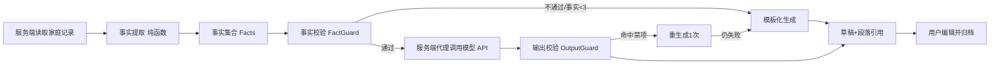

# 岁记-宝宝成长记录App-技术设计文档-TDD-v3.0-uniapp云端轻量版

## title: 岁记-宝宝成长记录App-技术设计文档-TDD-v3.0（uni-app 云端轻量版）

# 宝宝成长记录 App（暂定名「岁记」· uni-app 云端轻量版）技术设计文档 TDD v3.0

> 编写前提（v3.0 相对 v2.0 的根本变化）：**数据不再以本地存储为主，改为调用轻量云服务器接口**
> v2.0 单机版（本地 SQLite + 备份包交换）的存储路线**已废弃**；v3.0 回归"云端为主"，
> 但以**单实例轻量服务**（Python FastAPI + 关系库 + 文件/对象存储）落地，不引入微服务、多租户、增量游标同步等重型组件。
> 上游依据：《岁记-宝宝成长记录App-PRD-v1.2（云端轻量版）》
> 文档状态：初稿，待评审

## 一、文档信息

| 项 | 内容 |
| --- | --- |
| 产品名称 | 岁记（Baby Growth Log）· 暂定名 |
| 文档版本 | v3.0（uni-app 云端轻量版，取代 v2.0 单机方案） |
| 文档类型 | 技术设计文档（TDD） |
| 客户端栈 | uni-app (Vue3 + TypeScript) + uView-Plus / uni-ui |
| 服务端栈 | Python FastAPI + SQLAlchemy + PostgreSQL（开发期 SQLite）+ 对象存储/本地文件 |
| 目标平台 | Android 为主（App），H5 为辅；简体中文 |
| 编写日期 | 2026-10-23 |
| 上游文档 | PRD v1.2（存储路线由本地优先改为云端为主） |

### 变更记录

| 版本 | 日期 | 变更内容 | 变更人 |
| --- | --- | --- | --- |
| v1.0 | 2026-10-20 | 初稿：服务端模块化单体 + 增量游标同步 + 权限矩阵 + 灰度回滚 | 架构通 |
| v2.0 | 2026-10-20 | 架构路线重写为单机 + 文件备份同步，砍掉全部服务端 | 架构通 |
| v3.0 | 2026-10-23 | **存储路线回归云端**：数据与媒体统一上云，App 调用轻量云服务器 REST 接口；认证简化为 Token（账号密码+JWT）；家庭空间简化为"创建者/成员+只读开关"；取消本地优先与离线队列（纯在线）；后端选定 FastAPI 单服务 | 架构通 |

### 本次路线调整的决策依据

| 约束/诉求 | 影响 | 结论 |
| --- | --- | --- |
| 用户明确"数据不要本地存储" | 本地库不再作为主存储 | 云端为主，App 读写走 REST 接口 |
| "轻量级云服务器" | 不追求分布式与多租户 | 单实例 FastAPI + 关系库 + 文件存储，运维可控 |
| 换机不丢、家人协同 | 单机备份包交换不满足实时协同 | 统一云端存储，多端登录看同一份数据 |
| 仍守儿童信息底线 | 数据集中上云，泄露敞口变大 | 保留：TLS、静态加密、越权防护、单独同意、导出可控、删除彻底 |

## 二、架构目标（重排后的优先级）

| 优先级 | 目标 | 指标 | 验证 |
| --- | --- | --- | --- |
| P0 | 记录零丢失 | 云端保存 P95 ≤ 800ms；服务端确认才算成功 | 断网/杀进程测试 |
| P0 | 一人能维护 | 单实例服务、无分布式组件、部署脚本化 | 一键部署演练 |
| P0 | 数据不外泄 | 全部接口 TLS；敏感字段静态加密；越权防护 | 抓包 + 越权用例 |
| P1 | 换机不丢数据 | 新设备登录同一账号即恢复全部数据 | 换机演练 |
| P1 | 家人实时协同 | 同家庭多端可见彼此记录 | 双设备并发测试 |
| P2 | 性能 | 冷启动 P95 ≤ 1.5s；时光轴首屏 ≤ 800ms | 真机测 |
| P2 | 可用性 | 服务端月度可用性 ≥ 99.5% | 监控看板 |

### 2.1 明确不做（v3.0 范围裁剪）

| 砍掉项 | 理由 |
| --- | --- |
| 微服务 / 多实例 / 服务网格 | 轻量单服务足够，一人可维护 |
| 增量游标同步 / 字段级冲突合并 | 纯在线直写云端，单人单写场景不需要 |
| 本地优先写 + 离线同步队列 | 本期纯在线（列入后续 V1.3 演进） |
| 4 角色权限矩阵（CREATOR/ADMIN/COLLABORATOR/VIEWER） | 简化为"创建者/成员 + 只读开关" |
| 手机号 + 短信验证码登录 | 改用简单 Token（账号密码 + JWT），不接短信网关 |
| 熔断 / 限流 / 灰度回滚 | 自用/小规模，改为本地功能开关 + 版本号兼容 |
| 第三方崩溃/埋点 SDK | 不采集儿童数据；服务端自记日志即可 |

## 三、方案对比与选型

### 3.1 客户端框架候选

| 方案 | 成本 | 复杂度 | 风险 | 评价 |
| --- | --- | --- | --- | --- |
| 方案 A：**uni-app (Vue3 + TS)** | 低 | 低 | 中（原生能力需平台差异化） | **推荐**，沿用 v2.0 结论 |
| 方案 B：原生 Kotlin + Compose | 中 | 中 | 低 | 不推荐：一人团队难维护 |
| 方案 C：Flutter | 中高 | 中 | 中高 | 不推荐：国内生态弱 |

**结论**：选 A。客户端形态不变，仅把数据层从"本地 SQLite 仓储"改为"REST API 客户端 + 轻量内存缓存"。

### 3.2 后端技术栈候选

| 方案 | 成本 | 复杂度 | 风险 | 评价 |
| --- | --- | --- | --- | --- |
| 方案 A：**Python FastAPI（单服务）** | 低 | 低 | 低 | **推荐**：异步、自带 OpenAPI、AI 集成顺手，一人可维护 |
| 方案 B：Node.js + Express/Nest | 低 | 低 | 低 | 备选：与前端同语言 |
| 方案 C：Java Spring Boot | 中 | 中高 | 低 | 不推荐：对"轻量"目标偏重 |
| 方案 D：云开发/BaaS 托管 | 低 | 低 | 中高（厂商锁定） | 备选：若后续想彻底零运维可迁移 |

**结论**：选 A。FastAPI + Uvicorn + SQLAlchemy + Alembic，开发期用 SQLite、上线用 PostgreSQL，同一套代码切换连接串。

### 3.3 媒体存储候选

| 方案 | 成本 | 复杂度 | 风险 | 评价 |
| --- | --- | --- | --- | --- |
| 方案 A：**对象存储私有桶 + 签名 URL** | 低 | 低 | 低 | **推荐**：媒体不占应用服务器磁盘，访问可控 |
| 方案 B：应用服务器本地文件目录 | 极低 | 低 | 中（磁盘/备份） | 备选：小规模自用可行，需自行做磁盘备份 |

**结论**：优先 A；若追求极致轻量与零云厂商依赖，B 可作为自用起步，接口层抽象 `MediaStore` 使二者可切换。

### 3.4 认证候选

| 方案 | 成本 | 复杂度 | 风险 | 评价 |
| --- | --- | --- | --- | --- |
| 方案 A：**账号密码 + JWT Token** | 极低 | 低 | 低 | **推荐**：无短信网关、合规成本低，契合"轻量" |
| 方案 B：手机号 + 验证码 | 中 | 中 | 中（短信成本+合规） | 不采用（本期） |
| 方案 C：微信 OAuth | 中 | 中 | 中（需开放平台资质） | 备选：后续邀请链路走微信时评估 |

**结论**：选 A。JWT 含 `user_id`/`family_id`/`role`，短期有效 + 刷新令牌；敏感操作二次校验密码。

## 四、总体架构

### 4.1 系统全景（云端形态）

```mermaid
graph TB
  subgraph APP[手机 App · uni-app]
    UI[页面层 页面 + 组件]
    VM[状态层 Pinia Store]
    API[API 客户端层 请求/拦截器/缓存]
  end
  subgraph SRV[轻量云服务器 · FastAPI]
    GW[路由 + 中间件 JWT鉴权/限流/日志]
    BIZ[业务服务 记录/生长/里程碑/日记/家庭]
    AI[AI 编排 事实提取+模型调用+输出校验]
    REPO[仓储层 SQLAlchemy]
  end
  DB[(PostgreSQL / 开发期 SQLite)]
  OSS[(对象存储私有桶 / 文件目录)]
  LLM[大模型 API 服务端代理]
  UI --> VM --> API
  API -->|HTTPS REST| GW --> BIZ --> REPO --> DB
  BIZ -->|媒体签名URL| OSS
  BIZ --> AI --> LLM
```



**关键点**：App 不再持有主存储，所有业务读写经 HTTPS REST 到服务端；媒体经服务端签发 URL 直传对象存储或经服务端落盘。唯一敏感出网是 App↔服务端（TLS）与服务端↔模型 API。

### 4.2 分层与依赖规则

| 层 | 位置 | 职责 | 硬约束 |
| --- | --- | --- | --- |
| 页面层 | App | 渲染、事件转发 | 不直接发 HTTP，经 API 客户端层 |
| 状态层 | App | 跨页共享状态、内存缓存 | 只调 API 客户端层 |
| API 客户端层 | App | 请求封装、Token 注入、错误码映射、轻量缓存 | 统一 base URL，禁止散落 `uni.request` |
| 路由/鉴权 | 服务端 | JWT 校验、家庭归属、角色/只读判定 | 每个业务接口强制带 `family_id` 校验 |
| 业务服务层 | 服务端 | 用例、校验、聚合口径、AI 编排 | 纯逻辑，可单测 |
| 仓储层 | 服务端 | 数据库读写、对象存储交互 | 只被业务层调用 |

**理由**：业务规则（百分位、禁词、事实提取、校验）集中在服务端纯逻辑层，脱离 HTTP 可单测；客户端瘦身为渲染 + 调用。

### 4.3 目录结构

```
server/                         # FastAPI 服务
├── app/
│   ├── main.py                 # 入口、中间件注册
│   ├── api/                    # 路由（auth/entries/babies/measures/milestones/journals/family/media/export）
│   ├── core/                   # 配置、安全(JWT/密码哈希)、依赖注入、异常
│   ├── domain/                 # 纯业务：growth_lms、fact_extractor、output_guard、policies
│   ├── models/                 # SQLAlchemy ORM
│   ├── schemas/                # Pydantic 请求/响应模型
│   ├── services/               # 用例编排
│   ├── repositories/           # 数据访问
│   └── media/                  # MediaStore 抽象（oss / local）
├── alembic/                    # 数据库迁移
├── static/config/              # milestones.json / growth_lms.json / policies.json
└── tests/                      # pytest 单测

src/                            # uni-app 客户端
├── api/                        # 请求封装、拦截器、各资源 API
├── stores/                     # Pinia
├── pages/  components/  shared/  static/
```

## 五、服务端模块与 API 契约

### 5.1 资源与端点（REST）

| 资源 | 端点 | 说明 |
| --- | --- | --- |
| 认证 | `POST /auth/register` `POST /auth/login` `POST /auth/refresh` | 账号密码换 JWT |
| 家庭 | `GET/POST /family` `POST /family/invite` `POST /family/join` `PATCH /family/readonly` | 创建/邀请/加入/只读开关 |
| 宝宝 | `GET/POST/PUT /babies` `POST /babies/switch` | 多档案 |
| 记录 | `POST /entries` `GET /entries?baby&type&cursor` `PUT/DELETE /entries/{id}` | 10 类记录，分页游标 |
| 媒体 | `POST /media/upload-token` → 直传 → `POST /entries/{id}/media` | 签名 URL 直传后回填 |
| 生长 | `POST /measures` `GET /growth/curve?metric&range` | 服务端算百分位 |
| 里程碑 | `GET /milestones` `POST /milestones/achieve` | 清单静态 + 达成 |
| AI 日记 | `POST /journals/generate` `GET/POST /journals` `POST /journals/{id}/archive` | 服务端编排生成 |
| 导出 | `POST /export/pdf` `POST /export/data` | 服务端生成，返回下载 URL |

### 5.2 统一约定

| 项 | 约定 |
| --- | --- |
| 基础路径 | `/api/v1` |
| 鉴权 | `Authorization: Bearer <JWT>`，中间件解析并注入 `family_id` |
| 幂等 | 写接口接受客户端 `Idempotency-Key`（UUID），重复提交返回首条结果 |
| 分页 | `cursor` + `limit`（默认 20），返回 `next_cursor` |
| 错误码 | 401 未认证 / 403 越权或只读 / 404 / 422 校验失败 / 429 限流 / 5xx |
| 时间 | 入参/出参统一 UTC ISO8601，`occurred_at` 与 `created_at` 分离 |

### 5.3 记录类型 Schema 驱动

沿用 v2.0：10 类记录不写 10 套表单，服务端 `entry_type` + `value_payload(JSON)` + 一份 Schema 描述字段/校验/展示/统计策略；客户端表单引擎按 `GET /entry-schema` 渲染。新增类型只加一段配置。

### 5.4 生长曲线计算

LMS 参数随服务内置 `growth_lms.json`（含 `standard_version`），`domain/growth_lms.py` 纯函数计算百分位与 Z 值；客户端只做 Canvas 绘制，计算口径权威在服务端，保证多端一致与导出一致。

## 六、数据设计（云端 Schema）

### 6.1 表结构

| 表 | 关键字段 | 说明 |
| --- | --- | --- |
| `user` | `id`, `username`, `password_hash`, `created_at` | 简单账号，无手机号 |
| `family` | `id`, `creator_id`, `name`, `readonly`, `created_at` | 顶层隔离单元 |
| `family_member` | `id`, `family_id`, `user_id`, `role`(creator/member), `joined_at` | 两态角色；**一用户至多一行**（归属唯一） |
| `baby` | `id`, `family_id`, `name`, `birth_date`, `gestational_weeks`, `gender`, `created_at` | 多宝宝 |
| `entry` | `id`(UUID), `baby_id`, `family_id`, `type`, `occurred_at`, `created_at`, `creator_id`, `value_payload_json`, `is_backfilled`, `updated_at`, `deleted_at` | 核心表，软删入回收站 |
| `entry_media` | `id`, `entry_id`, `storage_key`, `sha256`, `size`, `width`, `height`, `url_signed` | 媒体元数据，原图在 OSS |
| `measurement` | `id`, `entry_id`, `metric`, `value`, `occurred_at`, `corrected_age_flag` | 测量 |
| `growth_point` | `id`, `measurement_id`, `percentile_p`, `z_score`, `standard_version` | 计算留痕 |
| `milestone_record` | `id`, `baby_id`, `milestone_id`, `achieved_at`, `source_entry_id`, `creator_id` | 达成记录 |
| `ai_journal` | `id`, `baby_id`, `range_start`, `range_end`, `title`, `body_md`, `citations_json`, `status`, `model_version`, `created_at` | 草稿/归档 |
| `consent_record` | `id`, `family_id`, `item`, `policy_version`, `accepted_at`, `operator_id` | 同意留痕 |
| `audit_log` | `id`, `family_id`, `action`, `actor_id`, `target_id`, `created_at` | 操作留痕 180 天 |
| `schema_version` | `version`, `applied_at` | Alembic 管理 |

索引：

```sql
CREATE INDEX idx_entry_timeline ON entry(family_id, baby_id, occurred_at DESC);
CREATE INDEX idx_entry_type      ON entry(family_id, baby_id, type, occurred_at DESC);
CREATE INDEX idx_member_family   ON family_member(family_id, user_id);
CREATE INDEX idx_media_entry     ON entry_media(entry_id);
```

**强制隔离**：所有业务查询经仓储层注入 `family_id` 条件；缺失该条件视为严重缺陷（代码评审 + 单测覆盖）。

### 6.2 数据完整性

| 机制 | 实现 |
| --- | --- |
| 外键 + 级联 | 媒体/测量/里程碑随 entry 级联 |
| 事务 | 一条记录 + 媒体元数据 + 测量值同事务写入 |
| 软删 | `deleted_at` 置位，30 天后定时任务物理删除（含 OSS 对象） |
| 幂等 | `Idempotency-Key` 唯一约束，重复提交命中返回既有行 |
| 家庭归属唯一 | 一用户同一时刻仅关联 1 个家庭：`user.family_id` 为唯一归属指针，`family_member` 同一 user 至多 1 行；凭邀请码加入 = 先与当前家庭解绑（旧家庭写 `leave` 留痕 + 创建者身份交接给最早加入的成员）再归属新家庭，个人资料与设置不随家庭变动 |
| 迁移 | Alembic 版本化，只做向前兼容新增列，破坏性变更需备份演练 |

## 七、媒体存储与上传

| 环节 | 方案 |
| --- | --- |
| 上传 | 客户端向 `POST /media/upload-token` 申请签名 PUT URL → 直传对象存储私有桶 → `POST /entries/{id}/media` 回填 `storage_key` |
| 访问 | 读取时服务端签发短时效 GET 签名 URL；无签名访问返回 403 |
| 本地文件备选 | `MediaStore` 抽象，自用起步可落服务器磁盘，接口不变 |
| 体积 | 单条 ≤9 图或 ≤3 视频；视频 ≤200MB；超限 422 |
| 去重 | 按 sha256 记录，同家庭内相同文件不重复存 |
| 失败 | 指数退避重试 3 次，仍失败保留记录并标记"媒体未上传"，可手动重试 |

## 八、认证与权限（简化模型）

### 8.1 认证

- 注册：`username + password`，密码 bcrypt 哈希存 `user`；无短信、无第三方登录。
- 登录：校验后签发 JWT（`access` 短期 + `refresh` 长期），载荷含 `user_id`/`family_id`/`role`。
- 中间件：每请求校验 JWT 有效性并解析当前家庭上下文；失效返回 401，客户端跳登录。

### 8.2 家庭与角色（两态 + 只读开关）

| 主体 | 能力 |
| --- | --- |
| 创建者（creator） | 记录、查看、邀请/移除成员、管理家庭、删除、导出 |
| 成员（member） | 记录、查看；仅删自己创建的数据；健康日志可见性可配置关闭 |
| 只读开关（family.readonly=true） | 全体非创建者置只读：可浏览共享相册，不可新增/编辑/删除 |

权限在服务端每次写操作时二次校验（不依赖客户端缓存），角色/只读变更 ≤60 秒生效。

### 8.3 与 PRD 承诺的差异（须向产品侧明确）

PRD v1.2 已同步简化：无 4 角色矩阵、无手机号验证、无免密实时协作推送（改为客户端拉取增量）。家庭归属以 `family_id` 为唯一隔离键，跨家庭访问一律 403。

## 九、AI 成长日记设计（服务端编排）

### 9.1 管线



### 9.2 与 v2.0 的关键区别

| 项 | v2.0 单机 | v3.0 云端 |
| --- | --- | --- |
| 事实提取 | 本机 | 服务端（读云端记录） |
| 模型调用 | 用户自备 Key、本机直连 | **服务端代理**，Key 存服务端环境变量，不下发客户端 |
| 输出校验 | 本机 | 服务端 `OutputGuard`，权威收口 |
| 兜底模板 | 本机 | 服务端 |

服务端代理的好处：Key 不进客户端、不随导出泄露；统一禁词与事实白名单校验；可按家庭做调用配额。请求体仅含结构化事实（type/entry_id/时间/聚合值），**不发送原图、姓名、精确健康明细**。

### 9.3 调用契约与降级

超时 30s；失败/超时/违规 → 重生成 1 次 → 降级模板化"基础版"；连续 3 次失败提示可关闭自动生成。输出结构固定：标题 + 3–6 段 + "这段时间的记录"清单，每段 ≥1 引用可跳原记录。

## 十、安全与隐私

| 维度 | 措施 |
| --- | --- |
| 传输 | 全链路 TLS 1.2+；客户端不信任自签证书 |
| 静态加密 | 敏感字段（健康日志、宝宝身份）服务端加密；密钥托管 KMS/环境变量，不随导出下发 |
| 媒体 | 私有桶 + 签名 URL，无签名 403 |
| 越权 | 接口级鉴权 + 对象级归属校验（IDOR 防护），失败留痕告警 |
| 注入 | SQLAlchemy 参数化，禁止拼接 SQL |
| 日志 | 服务端日志不打印完整密码、宝宝姓名、媒体明文 URL |
| 同意 | 建档前单独同意 + 分项勾选 + 留痕（`consent_record`）；撤回后停止处理 |
| 删除 | 注销二次验证，30 天内可撤销，期满含 OSS 对象彻底删除 |
| 第三方 | 不引入采集型 SDK |

**底线**：数据集中上云后，泄露敞口变大，因此越权防护、静态加密、签名 URL、最小化采集是 P0，不可裁剪。

## 十一、部署与运维（轻量）

| 项 | 方案 |
| --- | --- |
| 运行时 | Uvicorn + Gunicorn（多 worker），Nginx 反向代理 + TLS |
| 数据库 | 开发 SQLite / 生产 PostgreSQL；Alembic 迁移 |
| 对象存储 | 云厂商 OSS/S3 私有桶（或自用起步服务器磁盘） |
| 部署 | Docker Compose 一键起（api + db + nginx）；脚本化 |
| 配置 | `.env` 注入密钥/DSN/模型 Key，不入库不入仓库 |
| 备份 | 每日 `pg_dump` + OSS 跨区域/异盘备份；保留 7 份滚动 |
| 监控 | 接口错误率、P95 延迟、磁盘/配额告警；自记日志不上报第三方 |
| 升级 | 版本号单调递增；迁移前自动备份；保留上一版可回滚 |

**放弃项**：多实例、灰度、熔断限流——小规模自用/家庭场景收益低于成本，用 Nginx 基础限流 + 功能开关替代。

## 十二、异常与降级

| 异常 | 行为 | 用户可见 |
| --- | --- | --- |
| 无网络 | 保存请求失败，保留表单草稿不丢输入 | 当前无网络，无法保存 |
| 服务端 5xx | 客户端提示重试，草稿保留 | 服务暂时不可用，请稍后重试 |
| Token 失效 | 401 → 刷新令牌，失败跳登录 | 登录已过期，请重新登录 |
| 越权/只读 | 403，写操作拒绝 | 无权操作 / 权限已变更 |
| 媒体上传失败 | 退避重试 3 次，保留记录标记未上传 | 照片上传失败，可重试 |
| 存储配额超限 | 拒绝写入并提示 | 云端空间不足 |
| 模型 API 超时/失败 | 降级模板化"基础版" | 已生成基础版日记 |
| AI 输出违规 | 拦截重生成 1 次，仍失败降级 | 本次生成未通过质量校验 |
| 重复提交 | 幂等键去重返回既有记录 | 无（静默去重） |

## 十三、测试与验收清单

| 层级 | 范围 | 做法 |
| --- | --- | --- |
| 单元测试 | 服务端 domain（百分位、事实提取、禁词、校验、幂等） | pytest，覆盖率 ≥ 70% |
| 接口测试 | 鉴权/越权/幂等/分页/校验 | FastAPI TestClient + 用例矩阵 |
| 客户端联调 | 10 类记录、时光轴、曲线、日记 | 真机 |
| 换机演练 | 新机登录同账号即恢复数据 | 必做 |
| 并发 | 双设备同记录并发写 | updated_at 新者胜出 |
| 安全 | 越权全用例、抓包 TLS、签名 URL 403 | 渗透抽检 |
| 性能 | 冷启动、首屏、曲线渲染、接口 P95 | 低端机 + 压测 |

### 13.1 关键回归用例

| # | 用例 | 期望 |
| --- | --- | --- |
| 1 | 注册登录换 Token | 成功且载荷含 family_id/role |
| 2 | 断网保存 | 提示失败、草稿不丢 |
| 3 | 恢复网络重提 | 入库成功、无重复 |
| 4 | 含照片记录 | 原图入私有桶、签名 URL 可访问 |
| 5 | 越权访问他家庭数据 | 403 并留痕 |
| 6 | 只读开关开启 | 成员写操作被拒 |
| 7 | AI 生成（服务端代理） | 有引用、无禁词、Key 不下发 |
| 8 | AI 降级 | 无 Key/失败返回基础版 |
| 9 | 导出 PDF/数据 | 服务端生成、URL 可下载 |
| 10 | 注销 | 二次验证、30 天撤销、期满含 OSS 删除 |

## 十四、开发排期与工作量估算（一人团队）

> 以每周投入 15–20 小时（兼职）估算；全职可压缩约 40%。

| 阶段 | 内容 | 估时 | 里程碑产出 |
| --- | --- | --- | --- |
| P0 骨架 | FastAPI 工程、DB schema、Alembic、JWT 鉴权、CI | 1.5 周 | 能注册登录的空壳服务 |
| P1 记录主线 | 记录 CRUD、幂等、分页、媒体上传、客户端 API 层与时光轴 | 3 周 | **MVP：能记、能看、能同步** |
| P2 生长与里程碑 | 百分位服务、曲线接口、清单与达成 | 1.5 周 | 曲线与历程 |
| P3 家庭与权限 | 共享家庭、邀请/加入、只读开关、越权校验 | 1 周 | 多人协同 |
| P4 数据安全 | 静态加密、签名 URL、导出、注销与留存清理、备份 | 1.5 周 | **安全底线达成** |
| P5 AI 日记 | 事实提取、服务端代理、OutputGuard、模板兜底 | 2 周 | 差异化功能 |
| P6 加固部署 | Docker、Nginx TLS、监控、真机适配、回归 | 1.5 周 | 可上线 |
| 合计 | — | **12 周** | — |

**关键判断**：P0 鉴权与 P4 安全不可延后——数据上云后这是"不外泄"的底线；P5 AI 可延后，模板兜底先行。

## 十五、风险登记册

| 编号 | 风险 | 概率 | 影响 | 值 | 应对 | 状态 |
| --- | --- | --- | --- | --- | --- | --- |
| R-01 | 儿童数据集中上云，泄露敞口变大 | 3 | 5 | 15 高 | TLS+静态加密+签名URL+越权防护+最小化采集+定期渗透抽检 | 跟踪中 |
| R-02 | 单实例服务宕机导致无法记录 | 3 | 4 | 12 中 | Docker 快速重启 + 健康检查 + 后续 V1.3 离线暂存兜底 | 跟踪中 |
| R-03 | 一人维护服务端运维负担 | 3 | 3 | 9 中 | 单服务 + Docker Compose + 脚本化部署/备份 | 跟踪中 |
| R-04 | 对象存储/带宽成本超预期 | 2 | 3 | 6 低 | 媒体压缩、配额、生命周期清理；起步可用服务器磁盘 | 跟踪中 |
| R-05 | 越权/IDOR 漏洞 | 2 | 5 | 10 中 | 仓储层强制 family_id、接口鉴权单测全覆盖 | 跟踪中 |
| R-06 | 大模型费用/额度 | 3 | 2 | 6 低 | 服务端按家庭配额、调用前提示、模板兜底 | 跟踪中 |
| R-07 | uni-app 升级破坏兼容 | 2 | 4 | 8 中 | 锁版本、升级跑全量回归 | 跟踪中 |
| R-08 | 纯在线弱网体验差 | 3 | 3 | 9 中 | 本期显式接受；V1.3 引入离线暂存队列 | 跟踪中 |

## 十六、与 v2.0 的差异及与 v1.0 的收敛

| v2.0 单机设计 | v3.0 处理 | 说明 |
| --- | --- | --- |
| 本地 SQLite 主存储 | **废弃**，改云端 PostgreSQL/SQLite + REST | 数据统一上云 |
| 备份包导出/导入交换 | **降级**为可选离线副本 | 换机改为登录即恢复 |
| 本机调用模型 + 用户自备 Key | **改为服务端代理** | Key 不下发客户端 |
| 本地只读/应用锁开关 | **升级为服务端家庭+角色+只读开关** | 真正的多人协同 |
| 零网络请求 | **取消该目标** | 改为全链路 TLS + 越权防护 |
| 字段级/ID 合并 | **取消** | 纯在线直写，单人单写 |

相对 v1.0 的重型服务端：v3.0 **保留**云端为主，但**仍裁剪**微服务、增量游标同步、4 角色矩阵、灰度回滚——以单实例轻量服务落地。

## 十七、附录

### 17.1 架构决策记录（ADR）

#### ADR-001：客户端沿用 uni-app，数据层由本地仓储改为 REST 客户端
- 状态：Accepted
- 背景：用户要求数据不存本地、改调轻量云接口。
- 决策：uni-app 不变，新增 `api/` 请求封装层，Pinia 仅做内存缓存，主存储在云端。
- 后果：客户端瘦身、多端一致；接受断网不可记录的取舍。

#### ADR-002：后端采用单实例 Python FastAPI + 关系库
- 状态：Accepted
- 背景："轻量云服务器接口"诉求，一人可维护。
- 决策：FastAPI + SQLAlchemy + Alembic，开发 SQLite / 生产 PostgreSQL，Docker Compose 部署。
- 后果：开发快、运维轻、AI 集成顺手；放弃水平扩展，宕机即不可用（R-02）。

#### ADR-003：认证用账号密码 + JWT，不引入短信验证码
- 状态：Accepted
- 背景：轻量与合规成本优先。
- 决策：bcrypt 哈希 + JWT（access/refresh），敏感操作二次验密码。
- 后果：零短信成本、实现简单；账号找回依赖邮箱/人工（后续可补）。

#### ADR-004：家庭空间简化为"创建者/成员 + 只读开关"
- 状态：Accepted
- 背景：4 角色权限矩阵对自用/家庭场景过重。
- 决策：两态角色 + 一个家庭级只读开关；服务端每次写二次校验。
- 后果：满足家人协同；放弃精细到人到字段的权限。

#### ADR-005：媒体上云（私有桶 + 签名 URL），不做本地优先
- 状态：Accepted
- 背景：数据统一上云诉求。
- 决策：客户端申请签名 URL 直传私有桶，读取走短时效签名；`MediaStore` 抽象支持本地磁盘备选。
- 后果：换机媒体跟随、协同可见；泄露敞口与成本上升，以加密与配额对冲。

#### ADR-006：AI 日记由服务端代理调用模型，Key 不下发
- 状态：Accepted
- 背景：v2.0 用户自备 Key 在云端形态下不利统一治理。
- 决策：服务端编排事实提取→调用→OutputGuard，Key 存服务端环境。
- 后果：安全收口、可按家庭配额；服务端承担模型费用与可用性。

#### ADR-007：取消离线队列与字段级冲突合并（本期纯在线）
- 状态：Accepted
- 背景：用户明确不要本地存储，纯在线。
- 决策：记录直写云端，服务端确认即成功；并发写以 updated_at 新者为准。
- 后果：实现极简；弱网体验差登记 R-08，列入 V1.3 演进。

#### ADR-008：数据隔离以 family_id 为强制分区键
- 状态：Accepted
- 背景：多家庭共用一套服务。
- 决策：仓储层所有查询强制注入 family_id，缺失视为缺陷；越权一律 403 留痕。
- 后果：租户隔离清晰；需在每个接口与单测严格覆盖。

### 17.2 需求到设计的追踪矩阵

| PRD v1.2 需求 | v3.0 设计落点 | 差异说明 |
| --- | --- | --- |
| FR-01/02 快速记录 | §5.1 `POST /entries` + §5.3 Schema | 云端直写 |
| FR-04 时光轴筛选 | §5.1 游标分页 + §6.1 索引 | 无 |
| FR-06/07 生长曲线 | §5.4 服务端百分位 | 计算权威在服务端 |
| FR-18/19/20 家庭空间 | §8 两态角色 + 只读开关 | **简化**：无 4 角色、无手机号 |
| FR-26~30 AI 日记 | §9 服务端编排 | Key 服务端代理 |
| FR-31/32 导出与注销 | §5.1 导出 + §十 删除 | 服务端生成 |
| FR-33 备份 | §七 + §十一 备份 | 云端为主 + 可选导出副本 |
| FR-36/37 敏感数据与加密 | §十 + §七 签名 URL | **变化**：媒体上云并加密 |
| FR-39 在线可用 | §十二 异常 | **变化**：取消离线队列 |
| NFR-06/07/08 可靠性 | §5.2 幂等 + §6.2 | 提交幂等、无字段级合并 |
| NFR-14/15 安全 | §十 | KMS + IDOR 防护 |

### 17.3 交付前自查

| # | 检查项 | 结果 | 说明 |
| --- | --- | --- | --- |
| 1 | 存储路线符合用户诉求 | ✅ | 数据/媒体上云，App 调 REST（§四、§六、§七） |
| 2 | 轻量与一人可维护 | ✅ | 单服务 FastAPI + Docker（ADR-002、§十一） |
| 3 | 认证与权限符合 PRD v1.2 | ✅ | Token + 两态角色 + 只读开关（§八） |
| 4 | 儿童数据底线 | ✅ | TLS+静态加密+签名URL+越权+最小化采集（§十、R-01） |
| 5 | 取消本地优先/离线 | ✅ | 纯在线，离线列入演进（ADR-007、§5.6 演进） |
| 6 | 需求可追溯 | ✅ | §17.2 RTM 覆盖 PRD v1.2 主干 |
| 7 | 决策留痕 | ✅ | §17.1 八条 ADR |
| 8 | 风险登记 | ✅ | §十五，R-01 泄露敞口为最高优先级 |
| 9 | 未过度设计 | ✅ | 明确砍掉微服务/游标同步/灰度（§2.1） |

### 17.4 架构合规声明

本设计将儿童相关数据集中存储于云端，泄露敞口较单机版增大，因此把**全链路 TLS、敏感字段静态加密、媒体私有桶签名 URL、按 family_id 强制隔离与越权防护、最小化采集与单独同意**列为不可裁剪的 P0 底线。备份包/导出副本离开设备时仍须加密。涉及儿童个人信息的处理方案须经法务与专业顾问评审后方可上线。
